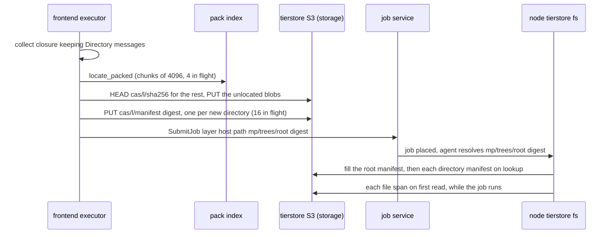
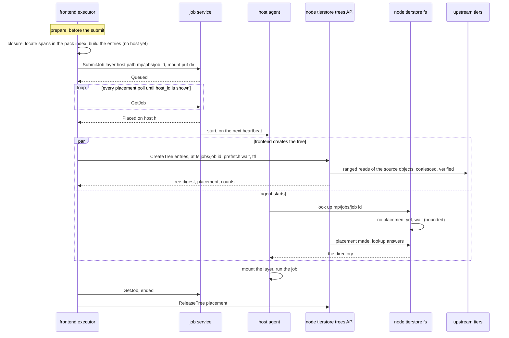
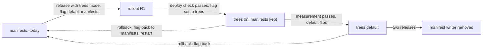
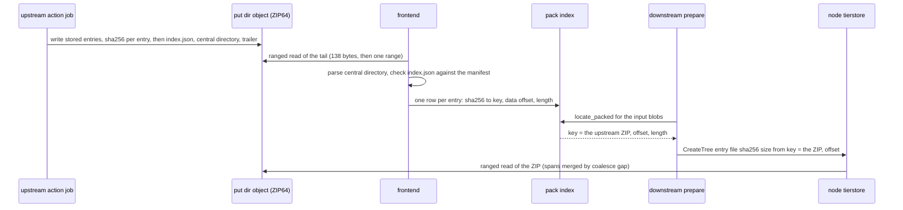

# Action input trees created on the job's node, through tierstore's trees API

Status: **DESIGN, for the owner's review (2026-11-15). Nothing is built; this pull request adds this file and one pointer line.**
Written against kbf `main` at `84086187e`, tierstore `main` at `b8ae6457` (its design
[node-local-trees.md](https://github.com/komira-ai/tierstore/blob/main/docs/design/node-local-trees.md) merged as komira-ai/tierstore#320; the
tracking issue is komira-ai/tierstore#326) and the jobscheduler revision kbf pins (`60b75be`). What this file says of today is marked **read**
(from that code or document), a figure from a run is **measured**, a figure worked out from them is **inferred**; a number with none of the
three is a default this design proposes, and every such number is a config key (section 4.2). Terms in bold are those of tierstore's
glossary. "The farm" places an action on a *virtual worker* of the executor; "the job service" is jobscheduler, which places each job on a *host*.

This document is a living problem-to-solution document: section 1 is the answer in one page, section 2 the problem, section 3 the finding that
shapes everything else, and sections 4 to 10 the design, flow by flow, with its latency budget, its model check and its landing order. Open
questions, each with a recommendation, are at the end (section 12).

Linked from [jobs-on-jobscheduler-and-tierstore.md](jobs-on-jobscheduler-and-tierstore.md) and
[one-pass-task-object.md](one-pass-task-object.md); the latter's "tierstore side" (its section 3) describes today's code until PR 7 of section 10.

## 1. The answer in one page

- **What changes for the build.** Today the frontend writes one JSON *manifest* per directory of an action's input root to tierstore with plain
  create-only S3 PUTs (`cas/l/<sha256 of the manifest>`), and the job's root is `<mp>/trees/<digest>`, resolved lazily on the node by
  `tierstore fs`. After this design the frontend sends **one `CreateTree` call to the tierstore of the host the job was placed on**, naming every
  file of the input root as a *span* (object key, offset, size) of an object tierstore can already read, and the job's root is the path the call
  names, `<mp>/jobs/<job id>`. No manifest is written to a store. Nothing about the Command, the action or the output changes.
- **Where the metadata in the ZIP is used.** An action's one-pass output object is a ZIP64 archive whose central directory the frontend
  already parsed once at ingest into the pack index, one row per file: `digest -> (object key, data offset, length)` (read:
  `record_put_dir_pack`). A downstream action's input file is that row. So its tree entry is `{path, sha256, size, mode, from: {key: <the
  upstream action's ZIP>, offset}}`: **a span of the upstream ZIP, with no copy and no `cas/l/` write**, and the frontend reads no ZIP bytes
  when it builds the entry (section 5).
- **Finding that decides the design (section 3).** The task text assumed the frontend learns the node during `prepare`. It does not: `prepare`
  runs before `SubmitJob`, and the job service chooses the host after it, with no way for a client to name one (read: `Constraints` has no host,
  `Job.host_id` is empty until `PLACED`, the API has no watch). The earliest moment the frontend can call a node is **the first read of the job
  that shows `host_id`**, which is jobscheduler's own documented hook (`job-rootfs.md` 7.3). The design therefore (a) builds the request in
  `prepare`, before the submit, (b) names the job's root by *job id*, a path known before the host is, (c) calls the host's tierstore on first
  seeing `host_id`, and (d) needs tierstore's `fs` lookup of that path to **wait** for the placement (bounded, below jobscheduler's 60 s lookup
  bound) instead of failing at once.
- **Recommendation on "should jobscheduler call `CreateTree` itself" (Q1).** No, for now: the frontend calls. Section 3.3 weighs it. The short
  version: the request is megabytes and kbf-specific (it would travel through the job service's state), the per-node dedup memory lives in the
  frontend, and jobscheduler is held to "generic only"; its advantage (no poll, no race, the key stays on the host) is real, and section 6 says
  which measurement would reverse the recommendation. Nothing in the design makes the move expensive: only the caller changes.
- **Prefetch.** `wait` by default (tierstore's default): the job starts with every byte local. A tree whose total size exceeds
  `--executor-trees-wait-max-bytes` is created with `background`. Latency on the start path is in section 6.
- **The old path.** Kept, per frontend, behind `--executor-input-tree manifests|trees` (default `manifests` until the measurement of section
  10 passes). It cannot be a per-node fallback, because the path the job names is fixed at submit, before the node is known (section 4.9).
  Removed two releases after `trees` is the default.
- **One-pass as the farm default.** A separate, later change, after the measurement of section 7 with trees on; independent of this design
  (trees work over packs too), better with it (fewer, larger source objects per action: fewer ranged reads on the node).
- **tierstore proto client.** A new crate `kbf-trees-client`, a typed tonic client with an in-process fake, built over a proto crate that
  tierstore publishes and kbf pins at one revision, the way `kbf-job-client` is built over jobscheduler's `js-proto` (section 8).
- **What the owner must decide** is in section 12. The two that block code: Q1 (who calls) and Q2 (tierstore's `fs` lookup waits).

## 2. The problem (read)

### 2.1 The flow today

(read: `action_tree.rs` `TreeWriter::write`, `action_tree/place.rs`, `executor/submit.rs` `put_dir_spec`, `executor/out.rs` `PutDirRoots::layer`.)

What this costs and why it is wrong for the owner's direction:

1. **Each new directory is a create-only PUT of a small JSON object** on the prepare path (`WRITES_IN_FLIGHT` 16). The memo (`memo.rs`, 100,000
   entries, 600 s) skips a directory the writer built lately; every other action pays the PUTs.
2. **The manifest is a tree only for one interface.** Through the S3 interface `cas/l/<digest>` is JSON and nothing more (tierstore's
   node-local-trees.md, section 1).
3. **The digest covers `source`** (where the bytes are), so the same input root from two pack layouts is two trees, and a repack orphans
   every manifest that named the old place.
4. **Every file is first read lazily, while the job runs**, from the job's wall clock (jobscheduler `job-rootfs.md` 7.4: "a lazy input is paid for
   while the job runs").

### 2.2 What the owner decided (2026-11-15, komira-ai/tierstore#326)

A tierstore `trees` interface, separate from S3, gRPC with types defined in proto, TLS-capable, authenticated by the existing tierstore keys.
`CreateTree` names explicit locations (an S3 bucket and prefix and/or an `fs` path); the tree is node-local; each file is a span of a cached
object; `prefetch` is `none | background | wait`; every file has a required `sha256` and a full Unix mode; the tree is read through plain S3
GET, HEAD and LIST and through the `fs` interface. The frontend runs on the NUC; jobs run on build nodes chosen by jobscheduler; jobscheduler
mounts an opaque host path read-only.

Note for the reader of tierstore's merged design: node-local-trees.md (#320) still describes the carrier as `POST /<bucket>?tree` on the S3
listener. The owner's decisions above supersede that carrier (issue #326 says so: "not on the S3 interface; a separate API"). This document
follows the decisions. The parts of #320 that do not depend on the carrier (the digest, the entries, `prefetch`, placements, lifetime, the
validation table, the failure table) are used as written and named by section.

## 3. The finding: the node is not known when the frontend prepares

### 3.1 What is known when

| Moment | What the frontend knows | Read from |
|---|---|---|
| Farm `Start` on a virtual worker | the lease, the action, the booking; **no host** | `executor/runs.rs` (`Waiting`), `pool.rs` ("the farm places on workers, and the job service decides where each job runs") |
| `prepare` (`submit.rs::prepare`): action facts, key mint, `ingest.mint` writes the tree, `inputs.tree` | the input closure, every blob's place; **no host** | `front.rs::mint_put_dir`, `submit.rs` lines 211 to 228 |
| `SubmitJob` | the job spec, final: `layers`, `mounts`, `needs`, `constraints` (os, arch, exec, isolation: **no host, no host label**) | jobscheduler `job.proto` `Constraints` |
| `GetJob` shows `PLACED` | `host_id`, from the commit of the placement; the start leaves for the host on its **next heartbeat** | jobscheduler `job-rootfs.md` 7.1 |
| The agent's `STARTING` | the agent resolves each host path (60 s bound each; a path that is missing fails the start at once as `input-unavailable`) | `job-rootfs.md` 4.7, 7.2 rules 3 to 5 |

So the task text's "the executor has a prepare step after placement ... the frontend learns the node then" holds for the farm's placement on a
virtual worker, which names no host. The frontend can name a host only after `SubmitJob`. A host path layer must be fixed at submit
(`JobSpec` is immutable), and a path that does not exist when the agent first looks fails the job `input-unavailable` after at most 60 s
(or at once). Rule 2 and rule 1 add: the frontend may see a later state than `PLACED` on its first read, and a job may be requeued to another
host (the start timeout, 900 s by default, counts from placement).

The API has no watch: jobscheduler decided so for the hook ("this design adds no watch", LR12), and the executor reads each job once per
`Config::poll` (default 1000 ms, read: `config.rs`). A frontend that reacts to `PLACED` as soon as it can reads often while a job is
`QUEUED` or `PLACED` (`job-rootfs.md` 7.3 says exactly that).

### 3.2 The options

| | Who calls, when | Needs from others | Start-path cost | Verdict |
|---|---|---|---|---|
| **A. The frontend, in `prepare`, as the task text says** | before the submit | a host, which does not exist yet | none | Not possible: no host to call. |
| **B. The frontend, on the first read that shows `host_id` (recommended)** | after `PLACED`, before or while the agent resolves the path | `fs` lookup of `jobs/<job id>` waits for the placement (Q2); the layer path names the job id | one poll delay plus one call, **overlapping** the heartbeat that carries the start and the agent's own preparation | Recommended. |
| **C. The frontend pins the host first** (a `host` constraint, then create, then submit) | before the submit | a new jobscheduler field and a way to choose a host, i.e. kbf scheduling placement itself | none on the start path, but the frontend picks hosts | Rejected: B15 (kbf scheduling is measured, not reserved) and the owner's "jobscheduler chooses". |
| **D. jobscheduler calls `CreateTree`** (a generic start hook on the agent) | on the host, in `STARTING`, before the lookup | a new generic field on `JobSpec` carrying the call; credentials on every host; the request passes through the job service | no poll, no race | Not now; section 3.3. |

### 3.3 Why the frontend calls (Q1), and what would change the answer

For D:

- it knows the host exactly, with no address mapping (Q6) and no poll;
- the call is on the host (loopback or a unix socket), so the tierstore key would live on each host and not on the NUC;
- no `fs` lookup wait would be needed if the agent's hook ran before the lookup.

Against D, and for B:

1. **The request is large and kbf-specific.** About 45 bytes per file entry (inferred, tierstore's estimate): 100,000 files is about 7 MB. A job
   spec travels through the job service's state store on every submit and is kept (`Job.spec`); jobscheduler's records are small and
   replicated. To keep the request out of the spec, jobscheduler would have to be given a *reference* (an object to fetch), which is the
   manifest-in-a-store design the owner is moving away from.
2. **The dedup bookkeeping is the frontend's.** Which subtrees exist on which node (section 5.3) is memory of what this frontend sent where;
   jobscheduler cannot answer `unknown child` for it.
3. **jobscheduler is held to generic only** (AGENTS.md R5 of both repositories: it never depends on kbf crates). A generic "call this local
   gRPC method with these bytes" hook is possible, but it is a new feature of a different repository, with its own credential and failure
   semantics (a call that fails must map to one of its start failure codes), before anything here can be measured.
4. **Failure handling is richer in the frontend**: it retries, resends a child inline, cancels, and settles the lease with a reason
   (section 4.7). The agent could only fail the start.
5. It needs **no change to jobscheduler**, and it is the shape jobscheduler documents for exactly this (7.3). A later move to D changes the
   caller and nothing else: the request, the location and the `fs` path are the same (the one-way doors are fixed once, section 4.3).

What would reverse the recommendation, to be read from the measurement of section 7: if, at the 95th percentile, the interval from
the `PLACED` commit to the frontend's call being sent is longer than the agent's own preparation before it looks up the path (so the *job
waits on the tree* for a reason that is the poll, not the work), ask jobscheduler for one of two small generic things, in this order: a
`GetJob` that waits for a state change (a long poll: additive, useful to every client), then the start hook of D.

## 4. The design

### 4.1 The flow

Everything that does not depend on the host is done in `prepare`, as today (closure walk, pack-index asks, writing the unlocated blobs to
`cas/l/`, the limits of `NoTree`). What `prepare` no longer does is write manifests. What it keeps is the *entries* of the tree in memory
(`TreeRequest`, section 4.4), bounded by the executor's `prepare_concurrency` per worker times the farm's slots: the same bound on what is held
as today's kept closure (`KeptClosure` is dropped when the preparation ends; the request is dropped once the call succeeds or the job ends).

### 4.2 Who calls, which node, which credentials (config)

The caller is the executor of the frontend (`kbf-server/src/executor`), one new stage between `Submitted::Running` and the job's first run read.
Every number is a flag with a default (AGENTS.md S2: flags, not environment; the key is secret material in a file).

| Flag | Default | Meaning |
|---|---|---|
| `--executor-input-tree` | `manifests` | `manifests` is today; `trees` is this design. Per frontend, flipped by an operator (section 4.9). |
| `--executor-trees-address` | `{host_id}:{port}` | How a job service host id becomes a tierstore trees address. `{host_id}` is the id `GetJob` shows; `{port}` is the next flag. Q6. |
| `--executor-trees-port` | tierstore's default for the trees interface | Written in the PR that adds the flag, from tierstore's documented default; not committed in this design. |
| `--executor-trees-key-file` | none; required with `trees` | The tierstore key (secret material, mode 0600, read like `--executor-job-token-file`). Q5. |
| `--executor-trees-ca-file` | none | A CA to pin for TLS to the nodes. Without it the channel is plaintext, and a start-line warning says so when an address is not loopback (B13: no enforced TLS). |
| `--executor-trees-prefetch` | `wait` | `none`, `background` or `wait`, the mode of a create. |
| `--executor-trees-wait-max-bytes` | 1 GiB | A tree whose file bytes exceed this is created with `background` whatever the mode says. Tuned by the measurement of section 7. |
| `--executor-trees-ttl-secs` | 1800 | The `ttl` of the create: it only has to outlive the time to the mount's attach, which holds the placement from then (tierstore 7), so twice the job service's start timeout (900 s, read). |
| `--executor-trees-placement-poll-ms` | 100 | How often a job that is `QUEUED` or `PLACED` and has no tree yet is read. |
| `--executor-trees-attempts` | 3 | Calls of one create before the job is cancelled (transport and busy answers only). |
| `--executor-trees-backoff-ms` | 200 | The first wait between attempts; doubled each time; a `Retry-After` of the answer replaces it. |
| `--executor-trees-call-timeout-secs` | 150 | One call's bound: above tierstore's `trees.create_timeout` (120 s default) so the node's own answer comes first. |
| `--executor-trees-child-min-entries` | 256 | A subtree with at least this many entries is created as its own tree and named by reference (section 5.3). |
| `--executor-trees-resident-entries` | 100000 | The bound of the memo of which trees a node has (section 5.3). |

**Which node.** The host id of `GetJob` through the address template. A job that is requeued shows another `host_id`; the stage creates again
there (section 4.7). The call is made over one channel per node, kept (HTTP/2 multiplexes the creates of one node); channels idle for a minute
are closed (inferred need; the number is part of the PR, as a flag). **Which credentials.** One tierstore key file for the whole fleet,
read by the frontend only, never logged, never in a job spec (the job has no network and no file of it: unchanged, B16). tierstore's rule
(#326, "defaults taken") is that only the full key may place a tree at an `fs` path, so this key is the full key of each node: the NUC frontend
then holds a fleet-wide full key. That is a decision for the owner (Q5); the recommendation is yes, one shared key, as the owner decided for
the BMC credential, and tierstore's unchanged "no new permission".

### 4.3 The mount path handed to jobscheduler

The job's one layer is the host path `<mp>/jobs/<job id>`, where `<mp>` is the mount point `--task-out-root` already derives (`<mp>/put`, so
`<mp>/jobs` is a sibling of `<mp>/trees`, as `PutDirRoots::trees` is today) and `<job id>` is `job_id(frontend, lease, 0)`
(`k<8 hex>-<term>-<seq>-<attempt>`, at most 62 bytes of letters, digits and dashes, read: `submit.rs`). The `CreateTree` names the same string
as its `fs` location: `{"interface": "fs", "path": "jobs/<job id>"}`. Properties:

- It is known before the host is, which is what makes B possible.
- The id is unique per frontend and attempt; a resubmit of the same id (the submit is idempotent on it) names the same location, and a create of
  the same tree at the same location is `created: false` (tierstore 3.3: idempotent), so a retry after a lost answer is safe.
- `jobs` is not one of the mount's own names (`trees`, `views`, `put`), so tierstore accepts it as a location (tierstore 3.2, "bad location").
- **The host agent must list `<mp>/jobs` as a read-only mount root** (`--mount-root-ro jobs=<mp>/jobs`), as it lists `trees` today
  (`out.rs` header). That is host configuration (the package that sets the agent's flags), done once before `--executor-input-tree trees` is
  set. A host without it refuses the start `input-not-allowed` by name (`job-rootfs.md` 2.6: a configuration mistake, fixed in the
  configuration).
- The S3 location of the create is **not** named: kbf reads trees only through the mount. An S3 location needs the empty-prefix LIST and the
  write grant of the prefix and buys nothing for a job. Q10.

The one-way doors of this section (the string `jobs/<job id>`, the `fs` location kind, the key and the proto message) are the ones fixed once:
they are the same under D, and under a later change of address mapping.

### 4.4 The tree entries, from the REAPI input root and the spans

`prepare` builds a `TreeRequest`: the list of entries `CreateTree` takes (tierstore 3.2) and the digest `T` of the tree, computed with
tierstore's own builder in the `tierstore` crate (the client library of D4: the same code the node runs, so a mismatch is a bug, not a
format). Entries come from the kept closure (`KeptDirectory`: files with `(name, digest, exec)`, directories, symlinks) walked to full paths:

| REAPI node | Tree entry |
|---|---|
| `FileNode` | `{path, kind: file, sha256, size, mode, from}` with `mode` `0755` if executable else `0644` (REAPI carries no more; `node_properties` are refused as today, `NoTree::NodeProperties`) |
| empty file | `{path, kind: file, sha256: e3b0c442..., size: 0}`, no `from`, nothing to fetch |
| `DirectoryNode` | implied by the paths below it; an empty directory is `{path, kind: dir}` |
| `SymlinkNode` | `{path, kind: symlink, target}` |
| the base tree | its top-level files are file entries; each top-level directory is a `tree` entry naming that directory's tree, created once per node (5.3). The frontend derives the base's own entries from the manifests of the release's base-tree bundle, which `base_publish.rs` already reads and writes as `cas/l/<sha256>` objects (read), so each base file is a whole-object entry with no `from` |
| `.kbf/action`, `.kbf/command`, `work` | the same names and blobs as today (`ADDED_ENTRIES`), as files and directories of the one request |

**`from`, the span.** For each distinct non-empty blob the frontend asks the pack index (`locate_packed`, as today) and takes the first of:

1. **A pack-index row** `(key, offset, length)` with `length == size`: `from: {key, offset}`. This is where the ZIP's metadata arrives (section 5).
2. **A whole object** `cas/l/<sha256>` of the blob's length (a HEAD, as today): no `from`; tierstore reads the whole object.
3. **Neither:** the blob is written to `cas/l/<sha256>` through the existing hash-while-streaming writer (`place::write_whole`, B16: read once, no
   whole-file buffering), then as 2.

An object of another length at `cas/l/<sha256>` stays `NoTree::WrongLength`. This reuses `place::locate` and `place::write_whole` unchanged;
the manifest encoder (`encode.rs`) and `write_manifest` are what the `trees` mode stops calling.

**Tree identity.** `T` covers names, kinds, modes, symlink targets and each file's `sha256` and `size`, and *not* `from` (tierstore D3). So the
same input root has one `T` whether its files are spans of packs, of one-pass ZIPs or whole objects, and on every node. That is the property
the memo below relies on, and the first place the pack-versus-ZIP question is answered: the format of the source object does not enter the tree.

**Limits.** `NoTree::TooManyEntries` and `TooDeep` keep their meaning, with tierstore's `trees.max_entries` and `max_depth` (the library
exports them as `MAX_ENTRIES` and `MAX_DEPTH` today); `trees.max_request_bytes` bounds a request, and a request over it is split by the child
rule of section 5.3 or refused by name.

### 4.5 The frontend's stage, step by step

For a job in `trees` mode, after a successful submit, per poll pass (and at `--executor-trees-placement-poll-ms` while it waits):

1. `GetJob`. `QUEUED`: nothing to do (no host; nothing was created, so a job that waits for capacity costs no node anything).
2. The first read that shows a `host_id` (any state at or past `PLACED`): address the node, send `CreateTree` (4.1) with the entries, the
   `fs` location, `prefetch`, `ttl`, `T` (so tierstore verifies the digest: `tree digest mismatch` is a bug report, not a retry).
3. On success: remember `(host, T)` as resident (5.3), keep the placement id, mark the job `treed`. The job needs nothing else from the frontend.
4. If the job shows a different host later (requeue, `job-rootfs.md` rule 1), go to 2 for the new host and release the old placement
   (best effort).
5. When the job ends (any terminal state, observed as today), `ReleaseTree` on every host created on (best effort; the lease expires anyway).

### 4.6 Prefetch: `wait` or `background`, and its latency on the start path

`wait` makes the call return when every range is in the node's cache and pinned, so no open of the job waits on the network; `background`
returns once the placement exists and the pulls are queued, so the job starts at once and a first read of an unfilled range joins the fill
(tierstore 5.1). The cost of `wait` is placed on the start path *by design*: it is the time the bytes would otherwise take from the job's wall
clock. The choice, per create:

- `wait` for a tree whose file bytes are at most `--executor-trees-wait-max-bytes` (default 1 GiB). Most action inputs are the base tree
  (already on the node after the first job: a `tree` entry, no fill) plus the action's own inputs, which are the outputs of the actions just
  before it in the build (warm on the node if it ran them, otherwise one read of the upstream ZIP, which the one-pass format makes one coalesced
  range, section 5).
- `background` above it, so one huge input does not hold a job's start for its whole transfer.
- The call-timeout (150 s) and tierstore's `trees.create_timeout` (120 s): a `wait` that times out leaves its fills running (tierstore 5.4),
  and the retry of the same create finds them present; the attempt counts as one of `--executor-trees-attempts`.

The latency of each is in section 6. The choice of 1 GiB is a guess to be tuned by measurement; it is a key so the tuning needs no release.

### 4.7 Failure and retry

All calls are idempotent by (tree, location) (tierstore 3.3), so a retry sends the same request. The frontend retries only what a retry can
fix, and **cancels the job** on anything else (`CancelJob`), so the slot is free at once and the job service does not wait out the 60 s
lookup bound of the agent. A cancelled job settles the lease `Infra` with the reason (so the farm may run the action again, a new attempt and
a new job id), except where it says `Invalid`.

| What the node answered | Retry? | Then |
|---|---|---|
| connection refused, reset, timeout, `UNAVAILABLE`, `DEADLINE_EXCEEDED` | yes: same request, up to `attempts`, doubling `backoff` | exhausted: cancel the job, settle `Infra` "tree not created on host h: ..." |
| busy / resource exhausted with `Retry-After` (tierstore 503 busy, 429 placements) | yes, after the answer's wait; counts as an attempt | as above |
| unknown child tree `<T>` (a `tree` entry's child is not on the node) | **once, not counted**: forget `(host, T)`, send the child's entries inline (section 5.3) | a second unknown child: cancel, settle `Infra` |
| source missing (`upstream 404`): a span's object is gone | no | the pack index is stale or the object was lost: drop the memo of the affected directories, cancel, settle `Infra`; the next prepare asks the index again |
| mismatch or short (tierstore 422): the bytes are not the entry's `sha256`, or the object is shorter | no | cancel, settle `Infra`, log by name, count (a lying object or an overwritten key: never silently retried) |
| location overlaps or taken (409) for an id this frontend made | no | cancel, settle `Infra`: a bug, since ids are unique |
| permission denied (403) | no | cancel, settle `Infra`, one error line naming the key's missing grant (a configuration mistake: fixed in the configuration, B20) |
| unimplemented, or the interface is off (`trees.enabled = false`, tierstore 501) | no | cancel, settle `Infra` "the node's tierstore has no trees interface": no per-node fallback exists (4.9); the operator's deploy check (4.9) is what prevents it |
| tree too large for the cache (507) | no on this node | cancel, settle `Infra`; the farm's next attempt may land elsewhere |
| the frontend restarts | n/a | the executor already cancels every live job an earlier process of the same frontend id left (`executor/mod.rs`); the new process prepares again |

A job whose tree was never created fails `input-unavailable` at the agent by its 60 s bound (or when tierstore's own lookup bound is shorter),
which the executor already settles as a failure of the host's input, not of the action. The cancel above makes that the rare path.

### 4.8 Lifetime and release

A placement lives from the create until `ttl` (1800 s default) after the last reader leaves, and while any mount holds it: the agent's
lookup attaches the path (tierstore 7), so a running job holds its tree. At the job's end the frontend sends `ReleaseTree` (4.5 step 5);
tierstore drops the record and unpins the packs, which stay in its cache until evicted, so a tree placed again soon after is warm. A frontend
that dies before releasing costs the node at most `ttl` of pinned bytes per job (bounded also by tierstore's `trees.max_placements`, 1024, and
`local_cache.pin_limit`; section 7).

### 4.9 What happens to the `cas/l` manifest path, and the cutover

- **Kept as the fallback during rollout, per frontend.** `--executor-input-tree manifests` is today's code path exactly: `TreeWriter::write`,
  `encode.rs`, `place::write_manifest`, `<mp>/trees/<digest>`. A job names its layer at submit; the node is unknown then, so the choice
  cannot be per node (the per-call fallback of tierstore's 8.3, on an `unknown POST` answer, needs a node to ask first). It is per
  frontend, made by the operator.
- **The check before the flip is a deploy step, not runtime machinery** (B20; and tierstore is a proxy: no probes of the store): before
  setting `trees`, the operator confirms every build node runs a tierstore with the trees interface and the `jobs` mount root. One
  check, once, in the rollout runbook; a node that was missed shows as `Infra` settles that name it (4.7).
- **Reversible.** Setting the flag back to `manifests` and restarting changes only jobs submitted after the restart; jobs in flight keep
  their layer (the executor cancels earlier processes' live jobs at start anyway). Manifests written before stay readable by the node
  (tierstore D10, B8). The agent's mount root for `jobs` is additive.
- **Removed after.** Two releases after `trees` is the default (the same schedule as tierstore's `hydrate` retirement, its 8.2), a pull request of
  its own deletes the manifest writer (`encode.rs`, `write_manifest`, the memo's manifest digests); `place::locate` and `write_whole` stay.
  tierstore keeps reading v1 manifests (its D10). No format is removed in kbf: the manifest was never a format kbf's other processes read.

### 4.10 The two memos

`memo.rs` today maps a `Directory` digest to its manifest digest and the subtree's measure, good for 600 s on the writer's clock. In `trees`
mode there are two, both bounded and both in the frontend:

1. **Directory memo (node independent).** `Directory digest -> T, measure, children, expires`. `T` is a pure function of the directory's
   content (4.4), so the memo is the same one-per-frontend structure, with `T` in place of the manifest digest. It still expires (600 s) so
   that the *spans* a rebuilt request names are not older than the pack index's answers.
2. **Resident memo (per node).** `(host, T) -> expires`: "tierstore on `host` has the tree `T`", set when a create returned and bounded by
   `--executor-trees-resident-entries`. It is advice: a stale entry costs one `unknown child` answer and one inline resend (4.7), never a wrong
   job, and tierstore pins a child while a parent that names it lives (tierstore 3.2), so a resident entry is true for at least as long as the
   last placement that used it.

## 5. The tree from an upstream ZIP, and shared subtrees

### 5.1 Where a downstream input's span comes from

(read: `one-pass-task-object.md` sections 3 and 5, `proxy/packed/commit/untrusted/one_pass.rs`, `output_index.rs`.) Three facts the design
relies on, each checked in the code:

- **The data offset is already the pack-index offset.** The one-pass reader computes a blob's offset from the central directory alone (a
  local header is `30 + name + 20` bytes), which is the first-data-byte offset tierstore's `offset` wants (tierstore 13 asked the frontend to
  record exactly this). No local header is read at tree-build time, and no ZIP is read at all: the one ranged read at ingest is the whole cost,
  paid once per action output, not once per downstream consumer.
- **The member's sha256 is the REAPI digest.** The ZIP's private extra field `0x4B42` holds the SHA-256; the REAPI `FileNode` digest is the
  same value; the pack-index row is keyed by it. So `sha256` of the entry, the ZIP's, and the index's agree by construction, and a lying
  object is caught by tierstore hashing the span as it fills (422, 4.7).
- **`mode`** is the REAPI executable bit (`0755`, `0644`): `.kbf/index.json` carries `exec` and not a full mode, and REAPI inputs cannot say more.
  A full mode through the ZIP is an additive field of `index.json` (B8: a reader skips unknown fields) and is not needed by any action input
  today. Q11.

What changes between packs and one-pass for a tree: with packs, a blob is a span of one of at most 8 packs, or a whole `cas/l/` object when it is
over the cap; with one-pass every blob of an action's outputs is a span of its **one** ZIP. For a downstream action with inputs from `k`
upstream actions the node reads about `k` objects instead of up to `8k + large`, and the spans of one ZIP merge (tierstore's
`trees.coalesce_gap`, 256 KiB, one GET if adjacent; the ZIP adds 68 bytes of header and 24 of descriptor between members, read:
`one-pass-task-object.md`). That is the reason to switch the farm default, and the thing to measure first (section 7).

### 5.2 `publish_output` in `trees` mode

`TreeWriter::publish_output` today builds manifests of each output directory at ingest, writes them create-only, and remembers them so a
downstream input root that holds an equal subtree finds the memo. In `trees` mode it keeps the *remembering* and drops the *writing*: it
computes `T` for each output directory from the derived `Directory` records (CPU only, the tierstore builder) and puts it in the directory
memo with its spans' key. The write that "costs the reuse, never the run" when a store refuses it disappears with the write. Where the
output is first used on a node, the request carries it as entries (or as a `tree` child, 5.3); nothing is stored for it.

### 5.3 Dedup of shared subtrees

Dedup happens at two levels, and only the second needs a protocol:

1. **Bytes: always, in tierstore.** Two files, two actions or two trees with one span are one fill and one cached range
   (tierstore 5.2, step 4). Sending the same entries twice costs request bytes and tierstore CPU, never a second fetch.
2. **Request size: shared subtrees.** A toolchain of 100,000 files is 7 MB (inferred) per create if sent flat. Such a subtree is a `Directory`
   every action of a language shares. The rule: a subtree with at least `--executor-trees-child-min-entries` entries (default 256) is created
   once per node as **its own tree** and named by `tree: <T_child>` in every later request to that node. The base tree is always one (its `T` is
   derived from the published base, 4.4). A child is created like any tree (it needs a location, Q4: v1 uses
   `jobs/t/<T hex>`, content-named, so equal creates are idempotent and shared) with `prefetch` as the request's, and is pinned by every
   parent while the parent lives.

   Decision per create, per node: for each subtree above the threshold in the closure (largest first): if `(host, T)` is resident, name it;
   otherwise create it first (one extra call, concurrently with the parent's other work, before the parent's). The parent is sent last, so the
   children it names exist. The cost of a node's first job is one create per large shared subtree; every later job to that node names it.

The protocol that matters is the one between the resident memo (advice) and the node (truth): the model of section 9 covers it.

## 6. Latency budget

Nothing below is measured except where it says so: the figures are shapes from the code and from tierstore's and jobscheduler's own
budgets, to be replaced by the measurement of section 7. The unit is milliseconds at the 50th percentile of a warm node unless a row says
otherwise. Rows that are the same as today say "unchanged".

### 6.1 Per operation, before the submit (the `Start` window, `prepare`)

| Operation | Today | `trees` mode | Note |
|---|---|---|---|
| closure walk, pack-index asks (`ceil(n / 4096)`, 4 in flight), HEADs of `cas/l/` (16 in flight) | unchanged | unchanged | read: `place.rs` |
| write of unlocated blobs to `cas/l/` | unchanged | unchanged | B16 |
| manifest PUTs: one per **new** directory, 16 in flight | `ceil(new dirs / 16)` rounds of a create-only PUT, 3 to 8 ms each (inferred: jobscheduler/tierstore design estimate) | **none** | the saving of this design on the prepare path |
| build the request: walk to paths, digest `T` | n/a | CPU, one pass over the entries (inferred: tens of ms for 100,000 entries) | on the prepare task, concurrent with the rest |

### 6.2 Per operation, after the submit (the start path)

| Operation | Today | `trees` mode | Note |
|---|---|---|---|
| job service: queue, placement | unchanged | unchanged | |
| frontend sees `host_id` | n/a | `placement poll`, mean half of `--executor-trees-placement-poll-ms` (50 ms at the default, inferred), worst the poll | the poll is the new cost; Q1 and section 3.3 say when it is too much |
| connect to the node | n/a | channel kept: 0 warm; first use a TCP and optional TLS handshake (inferred: a few ms on the LAN) | |
| `CreateTree` request, warm (every blob and child present) | n/a | one RPC: validate, build nodes, one LIST of the location (kept on, owner's default, measured by tierstore), write records, pin; no store request (tierstore 10, inferred) | |
| `CreateTree`, cold, `wait` | the same bytes are fetched **later, lazily, on the job's wall clock** | `ceil(R / fill_concurrency)` rounds of the store's service time plus `B / min(link, fill_rate)`, in the same pass (tierstore 10, inferred) | the bytes move from the job's wall clock to the start path; none is added |
| `CreateTree`, `background` | n/a | one RPC as warm, then fills while the job runs | the start path is as warm |
| agent: heartbeat that carries the start, host-path lookup, mount | unchanged | the lookup of `jobs/<job id>` **waits** for the placement (Q2): the two overlap, so the critical path is the *longer* of (heartbeat + agent preparation) and (poll + create), not their sum | `job-rootfs.md` 7.1, 7.4: 0.3 to 1 ms mount; the heartbeat interval is the job service's config and was not read here |
| first lookup of the tree on the node | fills the root manifest, then each directory manifest on lookup (3 to 8 ms each miss, jobscheduler/tierstore design, inferred) | a local lookup of a placement: no store request | removed from the job's creating phase |

**Net on a warm node, inferred:** `+ poll/2 + one RPC` against `- (manifest PUTs in prepare) - (manifest fills at the first lookup)`: about a
wash; neither side was measured. **On a cold node the total time to a job that has all its bytes is the same as today's lazy total, moved to
the start path, with the job's own opens no longer waiting on the network and a fill never fetched twice.** The honest risk is the poll; the
measure that decides it is the interval from the `PLACED` commit (`times.placed_at_ms`) to the call being sent, which the frontend records.

### 6.3 Per action, the whole budget

For an action of about 5 outputs and 200 KB (the budget of `jobs-on-jobscheduler-and-tierstore.md` 4, "about 5 to 12 ms" of added work,
estimates), trees mode adds on the start path, inferred and to be measured: poll mean 50 ms (an upper bound of the added latency), call 2 to
10 ms; on the prepare path it removes the manifest round trips; the output side is unchanged by this design (section 7 for one-pass).

## 7. Per-node tierstore load, and the measurements that gate the cutover

### 7.1 Load, per node

For a node with `s` job slots and a mean action time `t`, one create per job start gives about `s / t` creates a second (for illustration,
not a measurement: 64 slots and 4 s per action is 16 a second). Per create:

- **Request:** about 45 bytes per flat entry (inferred, tierstore's), the base tree and any resident large subtree as one entry each. A
  typical action with inputs spread over a few hundred files is some tens of KB; the first job of a node with a 100,000-file toolchain sends 7 MB
  once (5.3), then names it.
- **CPU:** one validate-and-digest pass over the entries, linear.
- **Disk:** a record and a placement written by rename, no fsync (the cache needs no durable writes, owner's rule); about 50 bytes a file
  entry (inferred, tierstore 14).
- **Store reads:** the ranged GETs of the missing spans, `trees.fill_concurrency` (8) at once **node-wide across all creates**, FIFO. This is
  the load figure to watch: with `s` jobs starting together, every cold create queues behind the node's 8 permits. It is tierstore's
  config; if the measurement shows start-path queueing, the lever is `trees.fill_concurrency`, not a kbf change.
- **Placements:** at most `s` live plus the leaked ones of a dead frontend for `ttl`, against `trees.max_placements` (1024) and
  `local_cache.pin_limit`. A `wait` create that would pass the pin limit is refused 507 (4.7), which is the node saying it holds too much.

From the frontend: one call per job per node, one channel per node (HTTP/2), a request held in memory from prepare until the call succeeds
(bounded by the executor's in-flight preparations).

### 7.2 What is measured, where, and what gates what

"Build while measuring": the PRs of section 10 are built as the approved design says, and the benchmark runs alongside, never instead. The
measurement runs on node-05 and the farm Mac, replaying one real build (the same Buck2 build of kbf itself, twice per configuration).

| Measurement | Configurations | Records | Gates |
|---|---|---|---|
| `placed -> create sent`, `create sent -> create returned`, `create returned -> Running`, per job | trees `wait` and `background`, packs and one-pass | p50, p95 of each, the fill bytes and counts the answer reports | Q1 (does the poll need a better mechanism); the value of `--executor-trees-wait-max-bytes` |
| action `prepare -> Running` and `Running -> committed` | manifests vs trees; packs vs one-pass | p50, p95 | the flip of `--executor-input-tree` to `trees` (section 10, PR 9) |
| ranged reads per downstream action on the node, bytes fetched, merged-range counts | packs vs one-pass | counts from tierstore's metrics | the flip of `--task-out-format` to `one-pass` (PR 10) |
| ingest time of a put dir | packs vs one-pass | p50, p95 (not measured in the one-pass document) | the same flip |
| cold cache, a put dir on the node's tierstore, several actions at once, memory of both writers | | | the unmeasured items listed in `one-pass-task-object.md` section 8, "Not measured" |

Tests never assert these (T10); the harness reports them, as `kbf-bench` already does for other phases.

**The flip of the farm default from packs to one-pass** is PR 10: a one-line default change in `--task-out-format`, behind its own
measurement. What the one-pass document already measured (single host, warm cache, no sandbox, three rounds): 170 MiB less read per action
(545.5 to 375.6 MiB), median task overhead 230 ms against 272 ms, objects 0.33% longer; not measured there are the rows above. The proposed
gate (Q9): trees on, node-05 and the farm Mac, the same build under both formats, and one-pass **not worse at the median and the 95th
percentile of `prepare -> committed`, with fewer ranged reads per downstream action**. Its rollout order is the one-pass document's
section 6 (every frontend and task image on the release, then the flag; roll the config back before the binary).

## 8. The tierstore proto client

kbf does not copy tierstore's proto and does not run `protoc` against another repository's files. It does what it does for jobscheduler:

- tierstore publishes a crate (suggested name `tierstore-trees-proto`) holding the `.proto` and the code `tonic-prost-build` generates, in its
  workspace; the golden of the generated code lives in tierstore (T19: a codegen change moves its goldens in the same PR). This design asks for
  it as task 0 of tierstore's #326 (section 11).
- kbf pins it at the **one** tierstore revision it pins `tierstore` and `objstore-s3` at (`Cargo.toml`, `rev = "aa00f82..." # v0.3.91` today):
  `tierstore-trees-proto = { git = ..., rev = <same> }`. A raise of the pin is a pull request of its own that runs the whole CI, never along with
  other changes (the comment at that line). A lint like `js_single_source` (one revision for every `tierstore-*` crate) is added by the PR that
  adds the dependency.
- A new crate **`kbf-trees-client`**: a typed async client over the generated messages and the tonic channel (TCP, then TLS pinned to one CA when
  `--executor-trees-ca-file` is set), with methods `create_tree`, `release_tree`, and an in-process **fake** (`FakeTreesServer`, a `fake`
  feature, as `kbf-job-client` has `FakeJobServer`) that keeps tierstore's rules for the tests that follow: idempotent create by (tree,
  location), `unknown child tree`, the 422 and 404 answers, `Retry-After`. Only `kbf-server` depends on it. It is not a pure crate (R4: tonic)
  and is added to `layers`/`layering.rs` like `kbf-job-client`. R9: one trait per seam only where there are two implementations (the real
  client and the fake behind one `TreesApi` trait used by the executor's tests: that is two).
- The authentication scheme of the trees API ("the existing tierstore keys") is tierstore's to define in its proto crate; this design assumes a
  credential in request metadata derived from the key file and asks for it by name (section 11).

## 9. Model check, before code

The one concurrency protocol this design adds is the frontend's, between three clocks: the job service (a job moves `QUEUED -> PLACED(h) ->
STARTING(h) -> RUNNING(h)`, may be requeued before running, may fail at the lookup's bound), the frontend (create, retry, memo, release) and
the node (placement, shared child, expiry). The properties:

1. **Never runs without its tree.** `RUNNING(h)` implies the placement is alive on `h` and its shared child exists on `h`.
2. **Release is complete.** After the frontend's release, no placement of the job is alive.
3. **Progress.** From every state in which the job is `PLACED` or `STARTING` and the frontend has not given up, a state with the job
   `RUNNING` is reachable: the resident memo can be wrong, a reply can be lost, a child can expire, and the job still gets its tree.

The model (one job, two nodes, at most two requeues, three failed attempts; the child may expire when no placement holds it; an unreleased
placement of an ended job or of a job on another host may expire; a reply may be lost after the node applied the create; the agent's lookup
may give up at any time while there is no placement) was run exhaustively as a scratch program (std Rust, breadth-first over every
reachable state), **measured**:

| Model | Reachable states | Running without a tree | Placement alive after release | Stuck before `RUNNING` | Ended and unreleased with a live placement |
|---|---|---|---|---|---|
| the design (unknown child: forget the memo, resend inline, not counted as an attempt; release at the end) | 1804 | 0 | 0 | 0 | 0 |
| the repair of an unknown child removed (a negative case: the same request is sent again) | 1271 | 0 | 0 | 168 | 0 |
| the release at the end removed (a negative case) | 1464 | 0 | 0 | 0 | 148 |

The two negative cases show that properties 2 and 3 can fail, so a green first row means something (T15). A first version of the model
counted the unknown-child answer against the attempts of the failure budget and **found 64 stuck states** (a job with two transport failures and
a stale memo gave up one answer short of success): the repair step must not use an attempt, which is the rule in 4.7.

PR 1 of section 10 commits this model as a Rust test in `kbf-server` (hermetic, no clock, no sleeps: T10, T12), with the three rows as three
tests, **before any code of the stage**. The property "never runs without its tree" holds in all three rows because the agent's lookup only
answers when the placement exists (Q2: the requirement of tierstore's `fs` that makes this true).

## 10. Compatibility, tests and landing order

### 10.1 Compatibility (AGENTS.md B8)

- **The frontend's two modes are additive.** `manifests` is byte for byte today's job spec and today's writes. `trees` adds a new layer path
  and a new call; no field of a shipped format changes.
- **The wire to tierstore is tierstore's** and additive there (a new interface, a new record type, tierstore D10).
- **The test that runs the previous release on new data and the reverse** (named in the PR that adds the stage):
  `manifests_and_trees_jobs_run_side_by_side` (a frontend in `trees` mode and one in `manifests` mode against one fake node: each job reads
  its own layer; the `manifests` job's spec equals today's byte for byte) and `a_manifest_tree_written_before_still_mounts_after`
  (tierstore side: its golden).
- **Mixed fleet.** A node without the trees interface is a configuration mistake caught by the one deploy check of 4.9; it is never a per-job
  runtime branch.

### 10.2 Tests by name (each a behaviour test in Rust, hermetic, with the fake of section 8; the ones with timing use an injected clock)

| Test | Behaviour it proves |
|---|---|
| `the_model_never_runs_a_job_without_its_tree` | model row 1: no reachable state has `RUNNING` without a live placement and child |
| `the_model_releases_every_placement_of_an_ended_job` | model row 1: after release none is alive; a model without the release fails it |
| `the_model_reaches_running_from_every_waiting_state` | model: progress; a model that does not repair an unknown child fails it |
| `a_tree_is_created_on_the_host_the_job_was_placed_on` | the create goes to the address of the `host_id` read, not to any other node |
| `a_job_that_is_still_queued_creates_nothing` | no call before `host_id` exists |
| `a_requeued_job_gets_its_tree_on_the_new_host_and_the_old_placement_is_released` | rule 1: a second create to the new host, a release to the old one |
| `an_unknown_child_is_sent_again_inline_once_and_uses_no_attempt` | 4.7: resend, forget the resident entry, attempts unchanged |
| `a_transport_failure_is_retried_with_the_same_request_until_the_attempts_are_used` | idempotent retry; then cancel and `Infra` with the host in the reason |
| `a_source_that_does_not_hash_to_its_entry_is_not_retried_and_the_job_is_cancelled` | 422: no retry, cancel, a counted log line |
| `a_missing_source_drops_the_memo_of_its_directories` | 404: the next prepare asks the pack index again |
| `a_job_settled_before_its_tree_was_created_calls_nothing_and_releases_nothing` | a cancel at `QUEUED` leaves the node untouched |
| `every_file_of_a_downstream_input_is_a_span_of_the_upstream_zip` | 5.1: the entry's `from` is the ZIP's key and the pack-index data offset, `sha256` is the REAPI digest, no ZIP byte is read |
| `the_tree_digest_is_the_same_for_packs_zips_and_whole_objects` | 4.4: `T` does not depend on where the bytes are |
| `an_unlocated_blob_is_written_to_cas_l_once_and_named_whole` | 4.4 case 3: B16, hashed while streaming |
| `a_large_subtree_is_created_once_per_node_and_named_after` | 5.3: the second job to a node sends a `tree` entry; a different node creates it again |
| `a_tree_over_the_wait_limit_is_created_in_the_background` | 4.6: `prefetch` follows `--executor-trees-wait-max-bytes` |
| `the_manifest_mode_sends_the_job_the_arguments_of_before` | B8: `manifests` is unchanged, byte for byte |
| `the_trees_flags_have_their_defaults_and_refuse_a_missing_key_file` | config: every key has its default; `trees` without a key file is refused at start |
| `a_plaintext_channel_to_a_remote_node_warns_and_connects` | B13: a warning at most |

### 10.3 Landing order (P7: one subject each; interfaces before the code that uses them; each reversible)

| # | Repository | PR | Depends on |
|---|---|---|---|
| 0 | kbf | **this design** (a file and one pointer line) | owner's answers to Q1 and Q2 |
| 1 | kbf | the model of section 9 as a test, three cases | 0 |
| 2 | tierstore | the proto crate and the trees API (tasks of section 11), released | tierstore #326 |
| 3 | kbf | raise of the tierstore pin to that release, **alone** (whole CI) | 2 |
| 4 | kbf | `kbf-trees-client` with its fake, layering entry and pin lint | 3 |
| 5 | kbf | `TreeRequest`: entries and `T` from the kept closure and the spans, and the base tree's entries from its bundle (pure, golden requests), memo with `T`; no behaviour change | 3 |
| 6 | kbf | the flags (`--executor-input-tree` and the keys of 4.2, default `manifests`), the `Inputs` seam that parks a request in place of a digest, metrics for the three intervals; no behaviour change in `manifests` | 4, 5 |
| 7 | kbf | the stage of 4.5: poll, create, retry table of 4.7, cancel, release, requeue; `publish_output` remembers and no longer writes in `trees` mode | 6, tierstore `fs` wait (Q2) |
| 8 | kbf | shared children and the resident memo of 5.3 | 7 |
| 9 | kbf | measurement harness runs and the report (section 7.2); then the flip of `--executor-input-tree` to `trees` | 7, 8 |
| 10 | kbf | the flip of `--task-out-format` to `one-pass` (own measurement and Q9) | 9 |
| 11 | kbf | removal of the manifest writer (two releases after 9) | 9 |

Host configuration (`--mount-root-ro jobs=<mp>/jobs`) ships in the host package before PR 9, not in these PRs. The one-pass document's section 3
gets its "tierstore side" paragraph updated in PR 7 (P10, T19).

## 11. What this needs from the other repositories

**tierstore** (tracked in komira-ai/tierstore#326; each is a request, not a decision of this repository):

1. A proto crate and a client-facing API: `CreateTree`, `ReleaseTree`, and a read of a placement (tierstore 3.1's three calls as RPCs).
2. **`fs` lookup waits** for a placement of a name under `jobs/`, up to a bound shorter than the agent's 60 s (a config key; Q2). Without it
   no create can race the agent's lookup safely.
3. **A create with no location**, for a tree that is only a child (Q4), or the v1 workaround `jobs/t/<T>`.
4. The credential scheme of the gRPC calls, and the grant needed to place at an `fs` path (the "full key" default).
5. In the create answer: counts of present and filled files and bytes (already in tierstore 3.3), which kbf records as the measurement inputs
   of section 7.2.
6. A revision of node-local-trees.md for the gRPC carrier (section 2.2 above).

**jobscheduler:** nothing required. Optional, by the measurement of section 3.3: a `GetJob` that waits for a state change.

**Host configuration:** the `jobs` read-only mount root (4.3).

## 12. Open questions for the owner, each with a recommendation

- **Q1. Who calls `CreateTree`: the frontend or jobscheduler?** Finding: the node is known only after the submit (section 3). Recommendation:
  **the frontend, on the first read that shows `host_id`** (option B), because the request is large and kbf-specific, the dedup memory is
  the frontend's, jobscheduler is generic-only, and it needs no jobscheduler change; revisit with a long-poll `GetJob` and then a generic start
  hook if the measured poll delay makes jobs wait on their tree (3.3).
- **Q2. May tierstore's `fs` lookup of `jobs/<job id>` wait for the placement?** Needed so the create and the agent's lookup may race.
  Recommendation: **yes**, bounded by a tierstore key (default 30 s, below the agent's 60 s), and a lookup that times out answers `ENOENT`
  as it does today.
- **Q3. Is `<mp>/jobs/<job id>` the name, and the agent's `jobs` mount root the host change?** Recommendation: **yes** (4.3); one-way doors fixed once.
- **Q4. Child trees with no location.** Recommendation: **ask tierstore for a create with no location**; until then `jobs/t/<T hex>`.
- **Q5. The NUC frontend holds one fleet-wide full tierstore key.** Recommendation: **yes**, one shared key in a 0600 file named by a flag, as
  decided for the BMC credential; the alternative (a scoped grant for placing at `jobs/`) is a tierstore permission and the owner said no new permission.
- **Q6. How a host id becomes a tierstore address.** Recommendation: the template `{host_id}:{port}` (minimal operator surface: no new
  inventory); the alternative, a host label the job service carries (`ListHosts` has labels), adds a field to maintain.
- **Q7. `wait` by default, `background` above a size.** Recommendation: **yes**, with `--executor-trees-wait-max-bytes` at 1 GiB until measured.
- **Q8. Per-frontend mode, not a per-node fallback.** Recommendation: **yes**, with one deploy check before the flip (4.9), because the layer
  path is fixed at submit.
- **Q9. The gate for one-pass as the farm default.** Recommendation: not worse at p50 and p95 of `prepare -> committed` and fewer ranged reads
  per downstream action, trees on, on node-05 and the farm Mac (7.2).
- **Q10. An S3 location in the create?** Recommendation: **none**; the job reads through the mount, and a location costs a LIST and a grant.
  Add it as an additive flag the day another client needs it.
- **Q11. Full Unix modes in a task's outputs.** REAPI inputs carry the executable bit only. Recommendation: **do nothing now**; add `mode` to
  `index.json` additively the day an action's output must carry it into an input.
- **Q12. Mac.** The flow is the same (the host id's tierstore on loopback, the layer is a mount below `/work`, `jobs-on-jobscheduler-and-tierstore.md`
  section 6). Recommendation: **include the farm Mac in the measurement of PR 9 and decide there**; nothing in this design is Linux-only except
  the unmeasured NFS read path.
